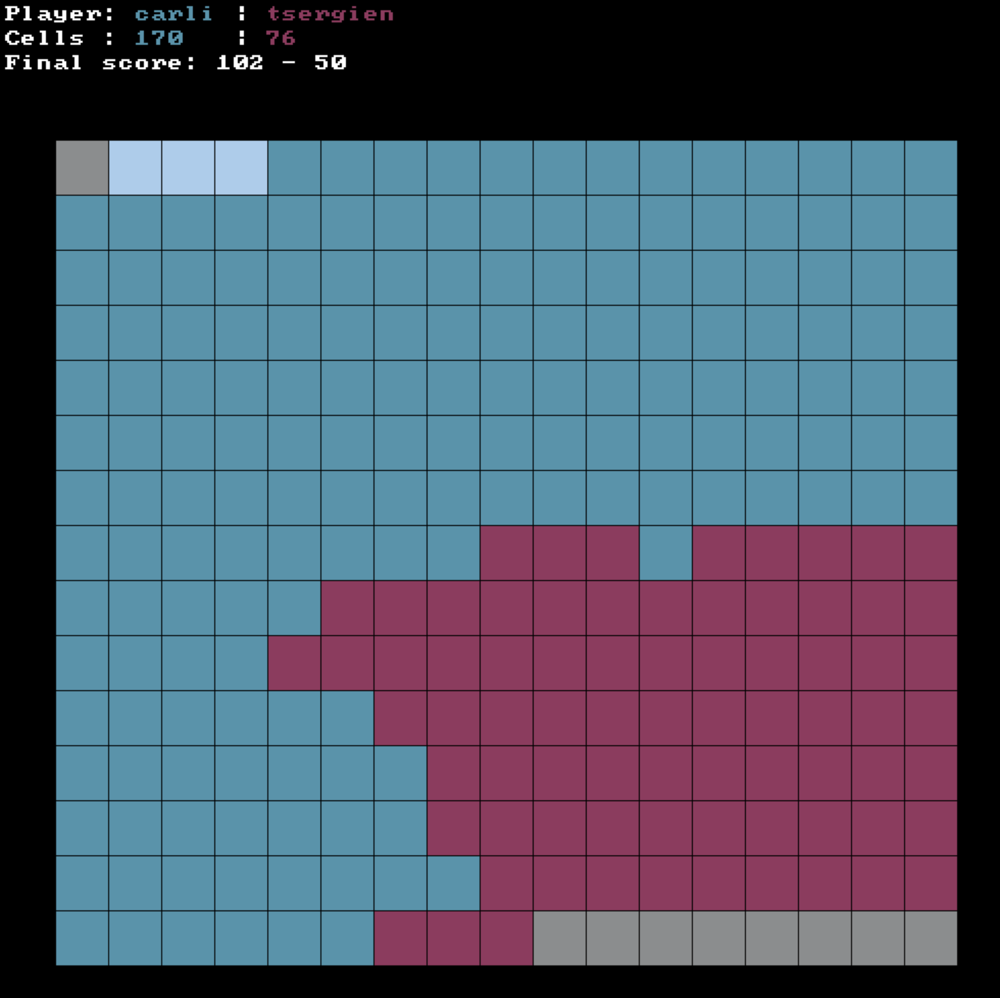
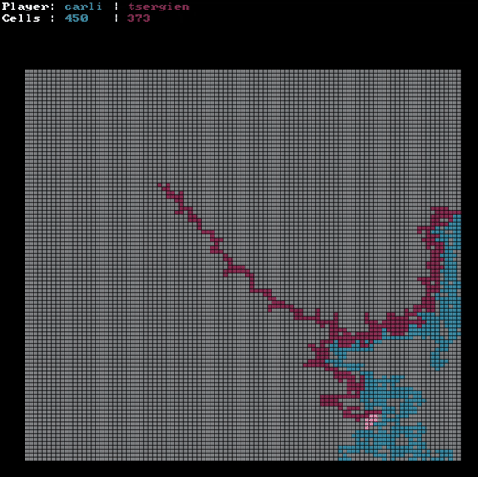

# Filler

`git clone --recurse-submodules https://github.com/tsergien/filler.git`

A bot for **Filler**, a two-player game from the 42 school curriculum (area control game or 'territory' game are some common names).

## The game

Two players share a grid. Each turn, the game gives a player a random piece,
and the player must place it so that it:

- overlaps **exactly one** of their own cells, and
- touches **none** of the opponent's cells.

A player who can't place a piece is out. When nobody can move, whoever covered
more cells wins.



The game itself is run by `resources/filler_vm`. Players are separate
programs: the VM sends them the board and the piece on stdin, and they reply
with a move (`Y X`) on stdout.

## How the bot plays

Each turn it:

1. Reads the board and the piece.
2. Builds a distance map: for every empty cell, how far it is from the
   opponent.
3. Tries the piece in every legal position and picks the one closest to the
   opponent, to cut off their space.


## Build and run
```sh
make          # builds libft and the bot -> ./tsergien.filler
./resources/filler_vm -f resources/maps/map00 \
    -p1 ./tsergien.filler -p2 players/carli.filler
```

- `-f` picks the map, `-p1` / `-p2` pick the players (swap them to play as X).
- Add `-q` for quiet mode (just the result).
- The final score is also written to `filler.trace`.

`./launch.sh` rebuilds everything and runs this game.

## SDL3 visualisation

The viewer reads the game's output, so pipe the VM into it:

```sh
brew install sdl3 cmake
make viewer
./resources/filler_vm -f resources/maps/map01 -p1 ./tsergien.filler \
    -p2 players/carli.filler | ./viewer/build/filler_viewer
```


